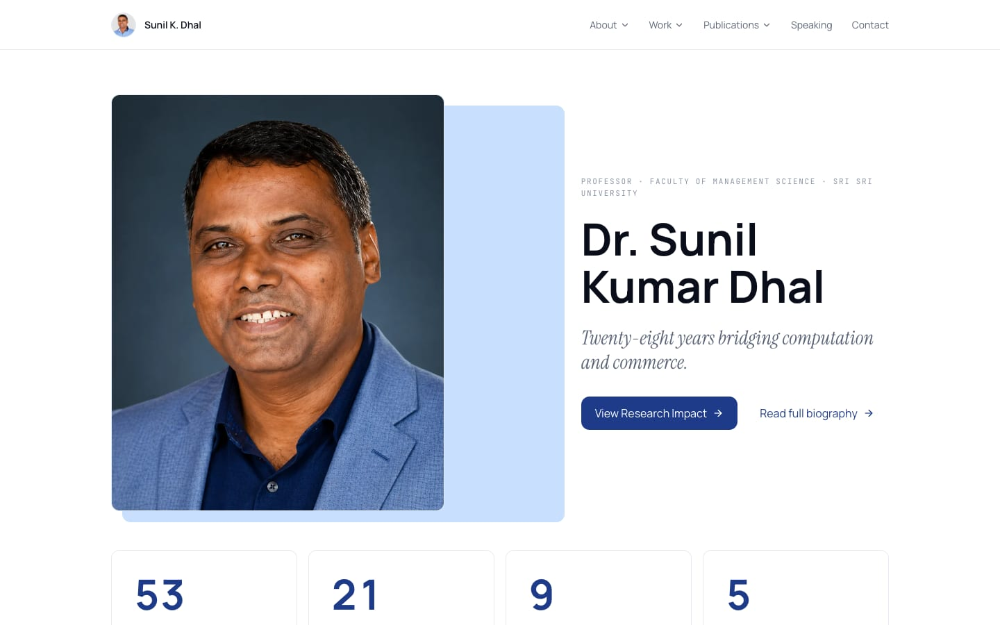
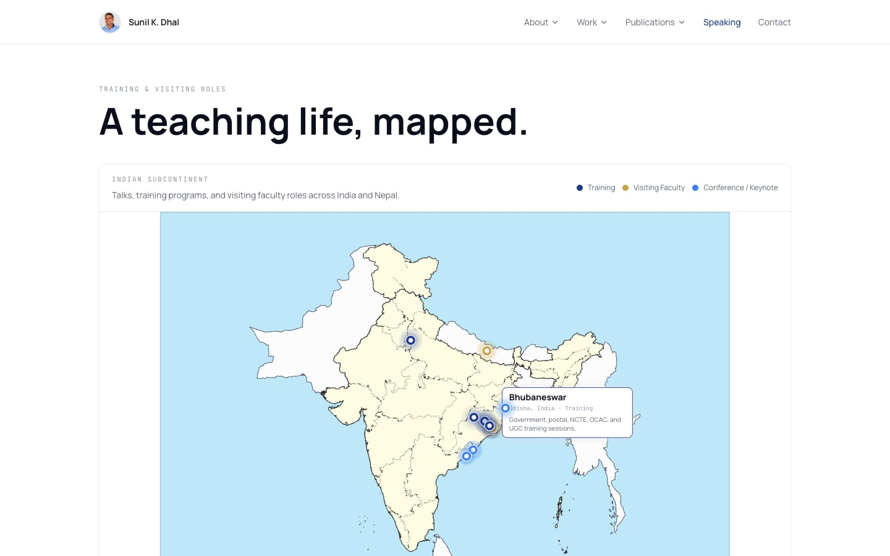
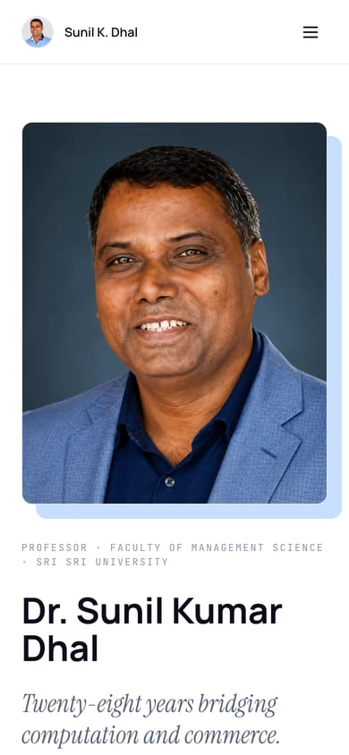

<div align="center">

# Dr. Sunil Kumar Dhal — Academic Portfolio

**Twenty-eight years bridging computation and commerce.**
Research, publications, speaking and impact of a Professor of Management Science at Sri Sri University.

[](https://react.dev)
[](https://www.typescriptlang.org)
[](https://vitejs.dev)
[](https://tailwindcss.com)
[](https://www.framer.com/motion/)
[](LICENSE)

[](https://vercel.com/new/clone?repository-url=https://github.com/Suraj-Dhal/sunil-kumar-dhal-portfolio)

</div>



## Overview

A fast, single-page academic portfolio for **Dr. Sunil Kumar Dhal**. It brings together 53 research articles, 9 books, 12 doctoral scholars, consultancy and editorial work, and a map of training and visiting-faculty roles across India and Nepal. All of it is driven from one typed data file, so updating the site never means editing layout code.

**Live demo:** coming soon (see [Deployment](#deployment)).

## Features

| Section     | Route                    | What it shows                                                            |
| ----------- | ------------------------ | ------------------------------------------------------------------------ |
| Home        | `/`                      | Portrait hero, headline metrics, citation chart and top papers           |
| About       | `/about/overview`        | Biographical timeline, from Kendrapara to Cuttack, and CV download       |
| Experience  | `/about/experience`      | 28 years across 14 academic and administrative roles                     |
| Awards      | `/about/awards`          | Recognitions and honours                                                 |
| Impact      | `/work/impact`           | Citations, h-index, i10-index and research-domain charts                 |
| Consultancy | `/work/consultancy`      | Consultancy projects                                                     |
| Editorial   | `/work/editorial`        | Journal editorial and review roles                                       |
| Research    | `/publications/research` | All research articles with publication-list PDF                          |
| Books       | `/publications/books`    | Authored and edited books                                                |
| Scholars    | `/publications/scholars` | Doctoral scholars supervised                                             |
| Speaking    | `/speaking`              | Interactive India/Nepal map of talks and training (d3-geo)               |
| Contact     | `/contact`               | Email and profile links for research, teaching and consultancy enquiries |

Also included:

- **Animated counters and charts** with Framer Motion and Recharts.
- **Legacy URL redirects** (`/books`, `/impact`, `/speaking/talks` and others) so old links keep working.
- **Responsive layout** with a mobile navigation menu.
- **SEO and social cards**: page title, description, and Open Graph and Twitter image.

<details>
<summary>More screenshots</summary>

| Speaking map                              | Mobile                                                                |
| ----------------------------------------- | --------------------------------------------------------------------- |
|  |  |

</details>

## Tech stack

| Area                | Tools                                                                         |
| ------------------- | ----------------------------------------------------------------------------- |
| Framework           | React 18, React Router 6, TypeScript 5                                        |
| Build               | Vite 5                                                                        |
| Styling             | Tailwind CSS 3, tailwindcss-animate, shadcn/ui (toast and tooltip primitives) |
| Motion and data viz | Framer Motion, Recharts, d3-geo, topojson-client                              |
| Quality             | ESLint 9, Prettier 3, Vitest 3                                                |
| Hosting             | Vercel (static SPA)                                                           |

## Project structure

```text
.
├── docs/images/               # README screenshots
├── public/
│   ├── documents/             # Downloadable CV / publication list (PDF)
│   ├── og-image.jpg           # Social share card
│   ├── favicon.ico
│   └── robots.txt
├── src/
│   ├── assets/                # Portrait, logo, India states TopoJSON
│   ├── components/
│   │   ├── charts/            # Citations, domains and publication-mix charts
│   │   ├── layout/            # Layout shell, top navigation, footer
│   │   ├── sections/          # Counter, timeline and top-papers blocks
│   │   └── ui/                # shadcn/ui primitives (toast, tooltip)
│   ├── constants/motion.ts    # Shared animation presets
│   ├── data/site.ts           # All portfolio content (single source of truth)
│   ├── hooks/                 # use-toast
│   ├── lib/utils.ts           # cn() class-name helper
│   ├── pages/                 # One component per route
│   ├── test/                  # Vitest setup and tests
│   ├── App.tsx                # Routes and redirects
│   └── main.tsx               # Entry point
├── index.html                 # HTML shell and meta tags
├── vercel.json                # SPA rewrite for client-side routes
└── package.json
```

## Getting started

**Prerequisites:** Node.js 18.18 or newer, and npm.

```bash
git clone https://github.com/Suraj-Dhal/sunil-kumar-dhal-portfolio.git
cd sunil-kumar-dhal-portfolio
npm install
npm run dev
```

The site runs at **http://localhost:8080**.

### Scripts

| Command             | Description                                                         |
| ------------------- | ------------------------------------------------------------------- |
| `npm run dev`       | Start the development server                                        |
| `npm run build`     | Build for production into `dist/`                                   |
| `npm run preview`   | Serve the production build locally                                  |
| `npm run typecheck` | Type-check with `tsc`                                               |
| `npm run lint`      | Lint with ESLint                                                    |
| `npm run format`    | Format with Prettier                                                |
| `npm test`          | Run tests with Vitest                                               |
| `npm run check`     | Typecheck, lint, format check, test and build (run before every PR) |

## Updating content

All text, numbers and lists live in [`src/data/site.ts`](src/data/site.ts):

- **Profile and metrics:** `profile`, `stats`, `citationsByYear`
- **Publications:** `allPublications`, `topPapers`, `books`
- **People and roles:** `scholars`, `experience`, `awards`, `consultancy`, `journals`

To replace the CV, overwrite `public/documents/sunil-kumar-dhal-cv.pdf` and keep the same filename. To change the portrait or logo, replace the `.webp` files in `src/assets/`.

## Deployment

The project is a static single-page app and deploys to Vercel with no extra configuration:

1. Click **Deploy with Vercel** above, or import the repository at [vercel.com/new](https://vercel.com/new).
2. Vercel detects Vite automatically. Build command: `npm run build`. Output directory: `dist`.
3. Once a domain is assigned, change the `og:image` and `twitter:image` URLs in `index.html` to the absolute address (for example `https://<domain>/og-image.jpg`) so social previews work.

`vercel.json` rewrites every path to `index.html`, so routes like `/publications/books` load correctly on refresh.

## License

The **source code** is released under the [MIT License](LICENSE).

The **content** (biography, publication data, photographs and CV) belongs to Dr. Sunil Kumar Dhal. It is **not** covered by the MIT License and may not be reused without permission.

## Maintainer

Built and maintained by [Suraj Dhal](https://surajdhal.com).
